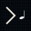

# jet.fish

A native terminal for the long way home

**See you Space Cowboy.**

## Crates

| crate | purpose |
| --- | --- |
| [`jetfish_protocol`](crates/jetfish_protocol) | screen-agnostic protocol primitives: cell-width model, SGR spans/attributes, grid geometry, palette |

## License

Licensed under either of [Apache-2.0](LICENSE-APACHE) or [MIT](LICENSE-MIT)
at your option.
